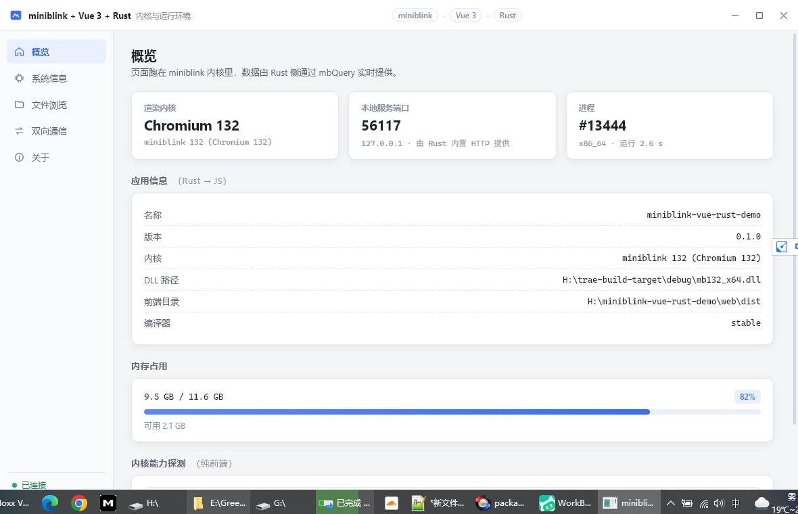

# miniblink + Vue 3 + Rust 桌面应用 Demo

用 **miniblink（Chromium 132 内核，单个 DLL）** 做渲染， **Vue 3 + Vite** 写界面， **Rust** 做原生宿主和业务逻辑的桌面应用骨架。



- 无边框窗口，标题栏完全由 Vue 绘制（最小化 / 最大化 / 关闭 / 拖拽都走 JS → Rust）
- 窗口可自由拖拽缩放：系统边框循环（激活态）+ 前端 resize 把手（`win.getSize`/`win.resize` IPC）
  双层互补；最小尺寸 900×600 由 `WM_GETMINMAXINFO` 原生子类化保证
- JS ⇄ Rust 双向通信：请求-响应（`mbQuery`）+ 服务端推送（`mbRunJs`）
- Rust 内置 HTTP 服务托管前端产物，不依赖外网、不需要额外打包工具
- 中英文双语：标题栏按钮 + 侧栏两处入口，零第三方依赖（见「中英文双语」）
- 可产出安装包：NSIS 绿色版 + 单文件 Setup.exe（19.65 MB），安装器界面仅中英双语；
  升级安装会先检测目标位置是否正在运行，让用户选择「关掉继续」还是「留在本页」（见「升级安装」）

---

## 快速开始

```bash
# 1) 获取 miniblink SDK（68MB，GitHub 不通时自动走镜像）
bash scripts/fetch-miniblink.sh

# 2) 一键构建（前端打包 + Rust 编译）
bash scripts/build.sh

# 3) 运行
./build_target/debug/mbvue.exe

# 4) 需要安装包时（NSIS，界面仅中英双语）
pnpm run dist            # → build_target/mbvue-Setup.exe（19.65 MB）
```

开发模式（前端热更新）：

```bash
bash scripts/dev.sh      # 起 vite(5173) + mbvue --dev
```

单独调试前端（不含原生能力，自动降级为 mock 数据）：

```bash
npm run dev    # 浏览器打开 http://127.0.0.1:5173
```

---

## 它是怎么跑起来的

```
┌─────────────────────┐
│  Vue 3 (build_dist)   │  界面、交互、路由
└──────────┬──────────┘
           │ mbQuery(JSON)  ──▶  mbOnJsQuery  ──▶  Rust 命令表
           │ window.__mbEmit ◀── mbRunJs ◀───────  Rust 后台线程
┌──────────┴──────────┐
│ miniblink mb132     │  Chromium 132，提供窗口 + WebView + JS 互操作
└──────────┬──────────┘
           │ C ABI (动态解析符号，无需 .lib)
┌──────────┴──────────┐
│ Rust 宿主           │  无边框窗口、内置 HTTP 服务、文件系统、系统信息
└─────────────────────┘
```

启动顺序（`src-rs/main.rs`）：

1. `libloading` 加载 `mb132_x64.dll`，逐个解析 `mb*` 符号
2. `mbInit(null)`
3. 起本地 HTTP 服务，把 `build_dist` 暴露在 `http://127.0.0.1:<随机端口>/`
4. `mbCreateWebCustomWindow(WS_POPUP)` 建无边框窗口——**创建时不带 `WS_THICKFRAME`**（原因见下）
5. 子类化窗口过程后，补上 `WS_THICKFRAME | WS_CAPTION | WS_SYSMENU`（Electron `frame:false` 同款组合）+ `WM_NCCALCSIZE` 把客户区扩成整个窗口；注册 `mbOnJsQuery` 回调
6. `mbLoadURL("http://127.0.0.1:<port>/")`
7. `mbRunMessageLoop()`

> **边框样式位的正确打开方式（踩坑实录）**：miniblink 的 webview 渲染视口按窗口
> **样式**算内边距——创建时若带 `WS_THICKFRAME`，视口从出生就内嵌 ~7px（定位在
> (7,7)），之后 `mbMoveWindow` / 补发 `WM_SIZE` 都改不回来，四边各露一圈未涂色带，
> 暗色主题下透出桌面/背后的窗口显白/灰边。正确做法是「创建时不带 `WS_THICKFRAME`
> → 子类化后补 `WS_THICKFRAME|WS_CAPTION|WS_SYSMENU`」：视口从出生就铺满整个窗口，
> 同时保住了系统原生边缘缩放、DWM 阴影、最大化撑满与 Win+方向键贴靠。实测只补
> `WS_THICKFRAME`（无 `CAPTION`）视口仍会内嵌 7px，`CAPTION` 是关键。
>
> 另：`mbMoveWindow(view, x, y, w, h)` 的 x/y 是**屏幕坐标**，启动时拿它做
> 「对齐客户区」会把窗口从居中位置挪到屏幕 (0,0)——无边框创建时视口本就是对的，
> 不要调。
>
> 不留 `ncHittestPaddingWidth` 边缘环：那圈留白会被 miniblink 涂成固定色（顶部白、
> 左侧黑），暗色主题下露白/黑边。webview 铺满整个窗口，四边颜色完全由页面绘制；
> 边缘缩放由 `WM_NCHITTEST` 自算命中区（左右下边框各 ~8px + 底部两角，系统原生
> resize 循环）+ 前端 `ResizeHandle` 把手（8~14px 内缩带）共同完成。

> 为什么不用 `file://` 直接打开 `index.html`：Vite 产物是 `<script type="module">`，
> 在 `file://` 下会被 CORS 拦掉。走本地 HTTP 就没这个问题，前端还能正常用 `fetch`。
>
> 官方 demo 里的 `mbEnableHighDPISupport()` 在本机会触发
> `NOTREACHED hit. Tried to RegisterCallback without an AtExitManager` FATAL，
> 因此没有调用（mb132 默认已处理高 DPI）。

### 暗色主题四边白边：排查过程

用户报「切暗色后顶部一行白色」，细看是**上/下/右三边**（左边未暴露）。完整排查过程：

1. **排除前端**：先查 `style.css` 的暗色变量覆盖与 TitleBar/SideBar 的硬编码颜色——
   边条位于 webview 绘制区之外，属于窗口边框区域根本没被绘制，与 CSS 无关。
2. **矩阵实验**：在 `main.rs` 里加环境变量开关（`MB_FRAME` 等），一次编译对比多种窗口
   创建方式，同时用屏幕级 BitBlt 采样四边像素——「创建时带 `WS_THICKFRAME`」稳定复现。
3. **根因**：miniblink 的 webview 视口内边距**按窗口 STYLE 计算，不按实际 client rect**
   （见上方踩坑实录）。创建时带 `WS_THICKFRAME` → 视口天生 (7,7) inset，四周 7px 不涂色，
   暗色主题下露出内核自绘的浅色底 (244,247,252)，即用户看到的白边。
4. **关键试错**：改为子类化后只补 `WS_THICKFRAME`（无 CAPTION）→ 仍是 7px inset、白边照旧；
   补上 `WS_CAPTION` 视口才填满——**CAPTION 是关键位，不是 THICKFRAME**。
5. **最终方案**：创建时不带 `WS_THICKFRAME`（诞生即满）→ 子类化后补
   `WS_THICKFRAME | WS_CAPTION | WS_SYSMENU` + `SetWindowPos(SWP_FRAMECHANGED)`，
   即上方启动步骤 4/5 的写法。
6. **验证**：预置 `config.json` 暗色主题启动，四边像素采样**白色占比 0%**
   （均值如 top (28,31,38)、bottom (22,24,30)、left (34,37,45)、right (46,54,69)）；
   原生边缘缩放、最大化/还原、三个窗口按钮、托盘全部回归通过；`cargo test` 10/10。

排查中的附带发现（均已写进代码注释）：

- `mbMoveWindow(view, x, y, w, h)` 的 x/y 是**屏幕坐标**，启动时拿它「对齐客户区」会把
  窗口从居中位置挪到屏幕 (0,0)——新架构下根本不需要调，已删除；
- `mbRunJs` 不能在 worker 线程调（段错误），JS 视口探针方案废弃，改用像素采样验证；
- 本机 `SM_CYPADDEDBORDER`(93) 返回垃圾值 648，`WM_NCHITTEST` 两个轴都必须用
  `SM_CXPADDEDBORDER`(92)。

---

## 双向通信

### JS → Rust（请求-响应）

miniblink 在页面全局注入了 `mbQuery`（DLL 内嵌脚本 `__globalThis__.mbQuery`）：

```js
window.mbQuery(customMsg, request, (customMsg, response) => { ... })
```

`src/bridge.ts` 把它包装成 Promise：

```ts
import { bridge } from './bridge'

const info = await bridge.sysInfo()          // 主机 / CPU / 内存 / 磁盘
const dir  = await bridge.listDir('C:\\')    // 列目录
await bridge.writeFile('/tmp/a.txt', 'hi')   // 写文件
await bridge.windowMinimize()                // 控制无边框窗口
```

Rust 侧 `src-rs/ipc.rs` 收到 `{"cmd":"sys.info","payload":{...}}`，查表执行后用 `mbResponseQuery` 回包。

### Rust → JS（推送）

任意 Rust 线程调用 `ipc::emit("tick", data)`，最终通过 `mbRunJs` 执行
`window.__mbEmit({event, data, ts})`，前端订阅即可：

```ts
import { on as onEvent } from './bridge'
onEvent('tick', (data) => console.log(data))
```

Demo 里「双向通信」页可以启停一个每秒推送的定时器（采样内存/CPU）。

### 命令表

| 命令 | 说明 |
| --- | --- |
| `app.info` | 应用与内核元信息 |
| `sys.info` / `sys.memory` | 主机、CPU、内存、磁盘 |
| `fs.drives` / `fs.list` / `fs.read` / `fs.write` | 本地磁盘读写 |
| `win.minimize` / `win.maximize` / `win.close` / `win.drag` / `win.title` | 无边框窗口控制 |
| `echo` / `compute.fib` / `compute.hash` | 往返延迟与算力演示 |
| `event.start` / `event.stop` | Rust 主动推送事件流 |
| `app.setLocale` | 同步界面语种给壳（影响 IPC 报错文案），返回生效的 tag |

---

## 中英文双语

界面语种有两个入口，任选其一：

| 入口 | 位置 | 说明 |
|---|---|---|
| **标题栏按钮** | 窗口右上角、最小化键左边 | 显示「另一种语言」的写法（当前中文时显示 `EN`） |
| **侧栏底部** | 左下角「当前语种」行 | 与标题栏等价，方便在窄窗口 / 最大化下触达 |

切换后同时生效：全部页面文案、时间/容量单位、**窗口标题**、`<html lang>` 属性，
以及 `localStorage` 持久化（下次启动保持）。

实现上刻意保持**零第三方依赖**（没用 vue-i18n）：`src/i18n/index.ts` 里
`ref` + `computed` + `t(key, params)` + `{name}` 插值，约 90 行。
理由是本项目卖点之一是「单 DLL + 极小宿主」，引入 i18n 库会让 bundle 和心智负担都不划算。

壳侧另有一份文案表 `src-rs/i18n.rs`：miniblink 页面与 Rust 是**两个运行时**，
前端拿不到 Rust 的模块，而 IPC 报错（如「读取目录失败」）会直接显示在界面的错误栏里。
只做前端切换的话，英文界面下报错仍是中文会很突兀，所以壳按前端同步过来的语种返回对应文案，
并由 `cargo test` 的 3 个用例守住（见下）。

```bash
# 两语种 key 集合必须严格一致（防止改了一边忘了另一边）
python scripts/check_i18n.py       # → zh-CN 140 / en-US 140，覆盖检查通过

# 壳侧文案随语种切换的单元测试
cargo test --release               # → i18n::tests 3 passed
```

---

## 安装包（NSIS）

```bash
pnpm run dist            # 完整：前端 + cargo build --release + 便携目录 + Setup.exe
pnpm run dist:only       # 跳过编译，只用现有产物重打包
```

产物两份，共用同一份文件清单，所以不会出现「装完少文件」：

| 产物 | 路径 | 体积 |
|---|---|---|
| 便携目录（绿色版，拷走直接跑） | `build_target/install/` | **66.5 MB** |
| 安装器（NSIS，双击安装） | `build_target/mbvue-Setup.exe` | **约 20 MB** |

安装器界面**只有简体中文 + English** 两种语言（`MUI_LANGUAGE` 各声明一次），
欢迎页 / 目录页 / 安装中 / 完成页 / 卸载确认全部双语。

### 安装后目录长什么样

装到 `C:\Program Files\mbvue-demo` 后只有 **4 个文件**：

```
mbvue-demo\
├─ mbvue.exe        0.73 MB   主程序（内含前端产物 + Explorer 图标）
├─ core.dll        65.77 MB   miniblink 内核（原名 mb132_x64.dll，装包时改名）
├─ icon.ico         0.01 MB   任务栏 / Alt+Tab 窗口图标
└─ uninstall.exe    0.05 MB   卸载器
```

> 运行时内核还会在同一目录写出 `LocalStorage\`、`cookies.dat`、`config.json`
> （记住窗口尺寸等配置），卸载时一并删除，不留尾巴。

三个设计决定：

1. **前端产物编译进了 exe**，不再有 `build_dist/` 目录。
   `build.rs` 扫描 `build_dist/` 生成一张资源表（`$OUT_DIR/mb_assets.rs`，
   每项一个 `include_bytes!`），`server.rs` `include!` 它，
   本地 HTTP 服务直接从内存表按 URL 返回。开发期走磁盘目录（vite build 完刷新即可，
   不用重编 Rust），release 走内嵌表 —— 由 `MB_ASSETS_EMBEDDED` 开关自动选。
2. **`mb132_x64.dll` 改名 `core.dll`**。安装目录里暴露内核内部版本号对用户没意义，
   `core.dll` 更贴合语义，也便于将来换内核版本时文件名保持稳定。
   开发期 cargo 产物目录里仍是原名，`find_dll()` 两个名字都认，所以改名不影响启动。
3. **运行时数据落在 exe 同级目录**：`LocalStorage\*.localsto`（界面语种等设置）、
   `cookies.dat`、磁盘缓存，以及 `config.json`（窗口尺寸等配置，放在 `window` 段下，
   顶层可扩展其它配置项）。
   卸载器会**一并清理**这些运行期产生的文件/目录，做到「卸载即清空、不留尾巴」。
   若装到 `Program Files` 等不可写位置，会自动回退写到 `%LOCALAPPDATA%\mbvue\`
   （同样由卸载器清理），避免写失败静默丢设置。
   磁盘缓存仍由 `mbSetDiskCacheEnabled(0)` 关掉（本地服务每次都发
   `Cache-Control: no-store`，缓存没价值）。

### 精简清单

安装后**4 个文件 / 66.6 MB**，相对原始 release 目录（122 MB）砍掉约 45%：

排除项及原因：

| 排除 | 大小 | 原因 |
|---|---|---|
| `mb132_x32.dll` | 55 MB | x64 进程在 Windows 上根本无法加载 |
| `mbvue.pdb` | 1.8 MB | 调试符号 |
| `build_target/deps/` `incremental/` | 余下 | cargo 中间产物 |
| `src/` `src-rs/` `vendor/` | 68 MB+ | 源码与 SDK，不随包分发 |
| `build_dist/`（旧版会装） | 0.12 MB | 已内嵌进 exe |

> 注意：**locale 无法再压**。miniblink 把 Chromium 132 内核与全部语言包**内嵌在
> `core.dll` 单个 DLL 里**（没有独立 `.pak` 文件），所以「只保留中英文」在
> 安装器界面层面已经做到，在内核资源层面做不到 —— 66 MB 是硬地板。

### 升级安装：目标位置正在运行时怎么办

老版本装下再装，会一路走到写文件阶段才撞上文件锁，弹出 NSIS 自带的
**「无法打开要写入的文件 / 中止·重试·取消」** —— 三个按钮都看不懂且没一个能解决问题。
现在改成**安装前主动检测**，让用户自己二选一：

| 场景 | 行为 |
|---|---|
| **图形安装**，目录页点「安装」 | 检测到同位置有实例在跑 → 弹双语确认框：**是**＝关掉它继续安装；**否**＝留在目录页（可换位置或取消） |
| **静默安装** `/S` | 无人可答，检测到后直接关掉旧实例并继续 |

**检测是启动安装程序时就后台跑的**，不是等点「安装」才开始：`.onInit` 里用
`ExecShell ... SW_HIDE` 异步拉起一次检测（不阻塞界面、不弹控制台窗口），让 PowerShell 的
启动开销与用户「选语言 → 看欢迎页 → 挑目录」的时间完全重叠。目录页点「安装」时直接读结果：

- 目录没被改过 → 用预检结果，**瞬时响应**（实测点「安装」到弹窗 0.03s，改造前要干等约 5s）；
- 用户在目录页改了位置 → 预检结果作废，用新位置重新检测（正确性优先）；
- 后台还没跑完（用户手速极快）→ 轮询等一下，最多 5s，再不行就退化成同步检测。

判定按 `$INSTDIR` **精确匹配**（按映像名 taskkill 会把用户别的目录里跑的便携版一起杀掉）。
「关闭」也合并成一次调用：脚本内部杀完后自己轮询等进程真正退出（最多 8s），
确认清空才继续；万一关不掉，给出明确提示，而不是把用户丢给中止/重试/取消。

> **NSIS 引号的两层坑（本次踩实录，勿再回头）**：检测原本用 `nsExec` 把 PowerShell
> 命令直接写在命令行里，结果命令被**两层**吃掉——① NSIS 单引号字符串里写 `''` 会被当成
> 「字符串结束 + 新字符串开始」（相邻字符串自动拼接），单引号直接丢失，WQL 退化成
> `Name=mbvue.exe` → “无效查询”；② `\"` 在 NSIS 里**不是**转义（NSIS 用 `$\"`），
> PowerShell 收到带反斜杠的引号后报 `TerminatorExpectedAtEndOfString`。
> 于是检测永远返回「没在跑」，形同虚设。**现在的写法**：把脚本写到 `$TEMP\*.ps1`、
> 用 `powershell -File` 执行（绕开命令行引号），并用**退出码**判读（1=在跑 / 0=不在跑）——
> 不用 `Write-Output` 比对字符串，避免尾随换行导致比较失败。
> 顺带：卸载段那两条（含 wmic）有同样的引号问题，也已统一到同一份实现。

### 端到端验证

```bash
python scripts/verify_installer.py     # 安装 → 启动 → 截图 → 占用态升级 → 卸载
```

会实际装到 `%TEMP%\mbvue-verify`、启动、抓图（`logs/verify-installer-zh.png` 与
`-en.png`，点击标题栏语种按钮前后各一张）、**在应用运行的情况下再跑一次安装器**
（回归用例，见下）、最后静默卸载并确认目录清空：

```
[1] 静默安装…  共 4 个文件 / 66.56 MB
    [OK] 精简生效：无 x32 dll / pdb / cargo 中间产物
    [OK] 必需文件齐全（4 项）
[2] 启动…      [OK] 窗口已出现 / [OK] 截图(中文) / [OK] 截图(英文)
[3] 占用态升级 应用已在运行 pid=17964（正占用 exe 与 core.dll）
               安装器退出码 0
               [OK] 旧进程已被自动关闭
[4] 静默卸载…  [OK] 卸载干净
```

> 第 `[3]` 步是专门用来**守住上面那个 bug 的回归测试**：先让应用占住 `mbvue.exe` 与
> `core.dll`，再跑一次安装器，要求退出码为 0 **且不允许卡住**（`subprocess.run` 有超时）。
> 实测把脚本回退到修复前的版本，这一步就会报
> `FAIL: 安装后旧进程仍在运行` —— 说明这道测试确实抓得住，不会像当年那样悄悄失效。

两个需要知道的坑（脚本里已处理）：

- **卸载前必须杀整棵进程树**。miniblink 内核会派生渲染/GPU 子进程，它们同样持有
  `mb132_x64.dll` 的句柄；只杀宿主 exe 的话文件锁没释放，卸载会删不掉。
- **卸载会清理全部运行期数据**。内核运行时在 exe 同级写 `cookies.dat` / `LocalStorage\` /
  `config.json`，卸载段已用 `Delete` / `RMDir` 显式清掉；若装到 Program Files
  不可写而回退到 `%LOCALAPPDATA%\mbvue`（或 UAC VirtualStore 重定向），卸载器也一并
  `RMDir`，无需手动清理。

---

## 目录结构

前端在**项目根**，Rust 单独放 `src-rs/`，两类构建产物各自独立成目录，互不干扰：

```
rust-vue-miniblink-demo/
├─ src-rs/             Rust 宿主源码（Cargo.toml 的 [[bin]] path 指向这里）
│  ├─ main.rs          入口：加载 DLL、建窗口、消息循环
│  ├─ ffi.rs           miniblink C API 的 Rust 绑定（运行时解析符号）
│  ├─ i18n.rs          壳侧文案表（IPC 报错随界面语种切换）
│  ├─ ipc.rs           命令分发 + Rust→JS 事件推送
│  └─ server.rs        内置 HTTP 服务，托管 build_dist/
├─ src/                Vue 3 前端源码（index.html + vite.config.ts 在根）
│  ├─ bridge.ts        mbQuery → Promise 的桥接层
│  └─ i18n/index.ts    零依赖 i18n 运行时 + 中英文案表（各 140 key）
├─ assets/             icon.ico / icon.png / icon.rc（exe 内嵌 + 窗口图标）
├─ build_dist/         前端产物（vite build 输出，outDir 见 vite.config.ts）
├─ build_target/       cargo 产物（.cargo/config.toml 的 target-dir）
│  ├─ release/         mbvue.exe + mb132_x64.dll
│  ├─ install/         便携目录（绿色版）
│  └─ mbvue-Setup.exe  NSIS 安装器
├─ vendor/miniblink/   mb132_x64.dll + mb.h（68MB，不入库）
├─ scripts/            构建 / 打包 / 验证脚本（见下）
└─ build.rs            把 DLL 与 icon.ico 部署到 build_target/<profile>/
```

改动前后对照：`src`(Rust) → `src-rs`；`web/`(前端) → 项目根；`web/dist` → `build_dist`；`target/` → `build_target`。

---

## 下载 miniblink（镜像）

`scripts/fetch-miniblink.sh` 会依次尝试这些镜像，任意一个通就能下：

```
https://gh-proxy.com/     （实测可用）
https://gh.llkk.cc/
https://gh-proxy.net/
https://ghps.cc/
https://gh-proxy.org/
```

也可以手动指定：`MB_MIRROR=https://你的镜像/ bash scripts/fetch-miniblink.sh`

SDK 来源：<https://github.com/weolar/miniblink49/releases>（tag `20251212`）

---

## 环境要求

- Windows（miniblink 仅支持 Windows）
- Rust 1.70+（MSVC 工具链，本项目用 1.99 验证）
- Node 18+

## 常用参数

```bash
mbvue                      # 加载构建产物
mbvue --dev                # 连 vite dev server (127.0.0.1:5173)
mbvue --url https://baidu.com
mbvue --dll <path>         # 指定 mb132_x64.dll
mbvue --web <dir>          # 指定前端产物目录
```

环境变量：`MB_DLL` / `MB_WEB_ROOT` / `MB_PORT`

## 关于启动方式

- 编译为 **Windows GUI 子系统**（`#![windows_subsystem = "windows"]`），双击 exe 直接启动，**不会弹出 cmd 控制台窗口**
- 日志统一写到 `logs/mbvue.log`（每次启动截断重写），排查问题看这个文件
- `build_target/` 固定在本项目内（`.cargo/config.toml` + 脚本里的 `CARGO_TARGET_DIR`），项目可整体拷贝/清理

## 说明

- 首次 `cargo build` 需要几分钟（windows-sys、sysinfo 体积较大）
- `vendor/miniblink/*.dll` 有 68MB，建议加进 `.gitignore`
- miniblink 是 Chromium 132 内核，支持 ES Module、CSS `:has()`、Container Query 等现代特性
- 页面里 F12 之外的调试：可用 `--url` 加载 Chrome DevTools 前端，或在 Rust 侧挂 `mbSetDebugConfig`

---

## 应用图标

`assets/icon.ico`（与前端 TitleBar.vue 的 logo 同款，由 `../desktop-demo-compare/gen_icon.py` 生成）分两条链路生效：

- **exe 内嵌**（资源管理器文件图标）：`build.rs` 经 `embed-resource` 调 Windows Kits 的 rc.exe
  把 `assets/icon.rc` 编成 .res 链接进 mbvue.exe；
- **运行时窗口**（任务栏 / 标题栏 / Alt+Tab）：`main.rs` 拿到 hwnd 后
  `LoadImageW(icon.ico)` + `WM_SETICON`（ICON_BIG 32px / ICON_SMALL 16px）。

验证：`python ../desktop-demo-compare/scripts/check_icons.py rust`（像素级校验 + 任务栏截图）。

## 实测数据与四套方案对比

本机（Windows x64）实测，测量脚本 `scripts/measure.py`（冷启动 = `CreateProcess` → 窗口可见；
内存 = 进程树工作集合计）。下表前三行为同一批次复测：

| 方案 | 冷启动（最快 / 平均） | 内存（进程树） | 分发体积 |
|---|---|---|---|
| **miniblink release** | **124 ms / 257 ms** | **79.8 MB** | ≈ 67 MB（exe 0.62 MB + DLL 66 MB） |
| **Electron 壳 + miniblink** | **1079 ms / 1163 ms** | **225.1 MB** | ≈ 334 MB（electron/dist + DLL） |
| Electron 33（Chromium） | 2657 ms / 3449 ms | 248.1 MB | ≈ 270 MB |
| Tauri 2 release | 1496 ms / 3491 ms（窗口空白，见下） | 318.0 MB | ≈ 3.3 MB |

```bash
# 自测
python scripts/measure.py build_target/release/mbvue.exe mbvue.exe --runs 3
```

**四套同功能项目**（同一份 Vue 前端 + 同一张命令表，只换传输层）：

| 项目 | 路径 |
|---|---|
| miniblink + Vue + Rust | `H:\rust-vue-miniblink-demo` |
| Tauri 2 + Vue + Rust | `H:\rust-vue-tauri-demo` |
| Electron 33 + Vue（Chromium 渲染） | `H:\electron-vue-miniblink-demo` |
| **Electron 壳 + miniblink + Vue** | `H:\electron-vue-miniblink-demo`（当前版） |

完整的横向对比（启动速度 / 性能 / 开发难度 / 生态 / 选型建议）见
`H:\desktop-demo-compare\四套方案对比报告.md` 与 `四套方案对比报告.html`。

> 环境备注：本机的 Tauri demo 因 WebView2 运行时在代理沙箱内崩溃（`0x80000003`
> Chromium CHECK 失败）而显示空白窗口，代码完整、需在正常 Windows 环境验证；
> miniblink 与 Electron 均正常渲染。
